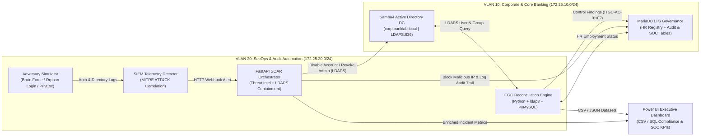

# Banking SOAR & ITGC Compliance Auditing Pipeline

A containerized **Defensive Security Engineering, SOC Automation (SOAR), and IT General Controls (ITGC) Compliance Pipeline** modeled on financial sector governance standards (**COBAC**, **ISO/IEC 27001**, and **PCI-DSS**).

Built to bridge **Identity & Access Management (Active Directory)**, **Relational Governance Data (MariaDB/SQL)**, **MITRE ATT&CK Detection Engineering**, **Automated LDAPS Containment**, and **Executive BI Reporting (Power BI)**.

---

## System Architecture

---

## Executive Power BI Reporting

See [docs/POWERBI_DASHBOARD_GUIDE.md](docs/POWERBI_DASHBOARD_GUIDE.md) for DAX measures and dataset schema details.

---

## Key Engineering & Audit Capabilities

### 1. Automated ITGC User Access Reconciliation (`itgc-audit/`)

- Queries Samba4 Active Directory over encrypted LDAPS (TCP/636) and reconciles `userAccountControl` and `Domain Admins` memberships against the MariaDB HR Registry (`hr_employees`).
- Flags `ITGC-AC-01` (Orphan Accounts), `ITGC-AC-02` (Privilege Creep), and `ITGC-AC-03` (Shadow Accounts), persisting audit evidence in SQL and CSV/JSON.

### 2. MITRE ATT&CK Detection Engineering (`telemetry/`)

- Real-time correlation engine detecting `SOC-001` (`T1110.001` Brute Force), `SOC-002` (`T1078.002` Terminated Account Abuse), and `SOC-003` (`T1098` Domain Admin Escalation).

### 3. Automated SOAR Playbooks & Live Containment (`soar/`)

- Enriches external source IPs via AbuseIPDB / VirusTotal REST APIs and executes automated containment via LDAPS (disabling compromised accounts, revoking unauthorized `Domain Admins` membership) and dynamic perimeter firewall blocklists.

---

## Project Milestones

- [ ] Phase 1: Segmented Docker Networks, Samba4 Active Directory DC, and MariaDB HR Registry.
- [ ] Phase 2: Python + Encrypted LDAPS ITGC Access Reconciliation & Power BI Dataset Export.
- [ ] Phase 3: Real-Time SIEM Telemetry Detector (MITRE ATT&CK) & Adversary Attack Simulator.
- [ ] Phase 4: FastAPI SOAR Orchestrator with Threat Intel Enrichment & Live AD Containment.
- [ ] Phase 5: Executive Power BI Dashboard, Shuffle SOAR Blueprint & Portfolio Documentation.
